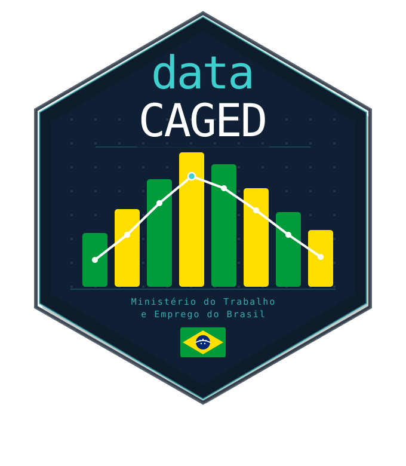
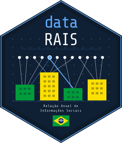

```{=html}
<div role="main">
```

::: {.hero-banner}
::: {.content-block}
::: {.hero-text}
[UFERSA · Mossoró/RN]{.gecomt-kicker}

# Grupo de Estudos sobre [Contabilidade]{.destaque} e [Mercado de Trabalho]{.destaque}

::: {.lead}
Pesquisa aplicada em contabilidade e mercado de trabalho,
com microdados públicos e ferramentas abertas para análise reprodutível.
:::

::: {.hero-actions}
[Leia o blog](blog/index.qmd){.btn .btn-gecomt .btn-gecomt-gold role="button"}
[Conheça o grupo](sobre.qmd){.btn .btn-gecomt .btn-gecomt-outline role="button"}
:::
:::

::: {.hero-logo}
{fig-alt="Logo do GECOMT"}
:::
:::
:::

::: {.content-block}
::: {.section-title}
[Linhas de pesquisa]{.gecomt-kicker}

## O que estudamos

Os trabalhos do grupo combinam teoria contábil, econometria aplicada e grandes bases de dados públicas.
:::

::: {.grid .gap-4}
::: {.g-col-12 .g-col-md-4}
::: {.gecomt-card}
[`<i class="bi bi-briefcase-fill" aria-hidden="true"></i>`{=html}]{.gecomt-icon}

### Mercado de trabalho contábil

Perfil dos profissionais contábeis no mercado formal, demanda por habilidades e tendências da profissão.
:::
:::

::: {.g-col-12 .g-col-md-4}
::: {.gecomt-card}
[`<i class="bi bi-cash-coin" aria-hidden="true"></i>`{=html}]{.gecomt-icon}

### Remuneração e desigualdades

Diferenças salariais por gênero, raça, região e setor de atuação, com métodos de decomposição.
:::
:::

::: {.g-col-12 .g-col-md-4}
::: {.gecomt-card}
[`<i class="bi bi-people-fill" aria-hidden="true"></i>`{=html}]{.gecomt-icon}

### Emprego e políticas públicas

Emprego formal, rotatividade e avaliação de políticas como o seguro-desemprego, com microdados do CAGED e da RAIS.
:::
:::
:::
:::

::: {.content-block}
::: {.section-title}
[Ferramentas abertas]{.gecomt-kicker}

## Pacotes do GECOMT

Pacotes R desenvolvidos pelo grupo para acessar, em poucas linhas de código, os principais
microdados do mercado de trabalho formal brasileiro.
:::

::: {.grid .gap-4}
::: {.g-col-12 .g-col-md-6}
::: {.gecomt-card .pacote-card}
{fig-alt="Logo hexagonal do pacote dataCAGED" .pacote-hex}

### dataCAGED

Microdados do CAGED (Novo CAGED, CAGED antigo e ajustes) baixados, lidos e gravados em DuckDB
com uma única função. Disponível no CRAN.

[Conheça o dataCAGED](pacotes/datacaged.qmd){.btn .btn-gecomt .btn-primary .btn-sm role="button"}
:::
:::

::: {.g-col-12 .g-col-md-6}
::: {.gecomt-card .pacote-card}
{fig-alt="Logo hexagonal do pacote dataRAIS" .pacote-hex}

### dataRAIS

Microdados da RAIS de 1985 a 2025 (vínculos e estabelecimentos), com nomes de variáveis
padronizados entre os diferentes leiautes históricos.

[Conheça o dataRAIS](pacotes/datarais.qmd){.btn .btn-gecomt .btn-primary .btn-sm role="button"}
:::
:::
:::
:::

::: {.section-alt}
::: {.content-block}
::: {.section-title}
[Blog]{.gecomt-kicker}

## Publicações recentes

Notas de pesquisa, tutoriais com dados abertos e comentários sobre temas contábeis e trabalhistas.
:::

::: {#ultimos-posts}
:::

::: {.text-center .mt-4}
[Ver todas as publicações](blog/index.qmd){.btn .btn-gecomt .btn-primary role="button"}
:::
:::
:::

::: {.content-block}
::: {.cta}
## Faça parte do GECOMT

Discentes de graduação e pós-graduação interessados em pesquisa com dados contábeis e do mercado
de trabalho podem entrar em contato com a coordenação do grupo.

[Saiba como participar](sobre.qmd#contato){.btn .btn-gecomt .btn-gecomt-gold role="button"}
:::
:::

```{=html}
</div>
```
