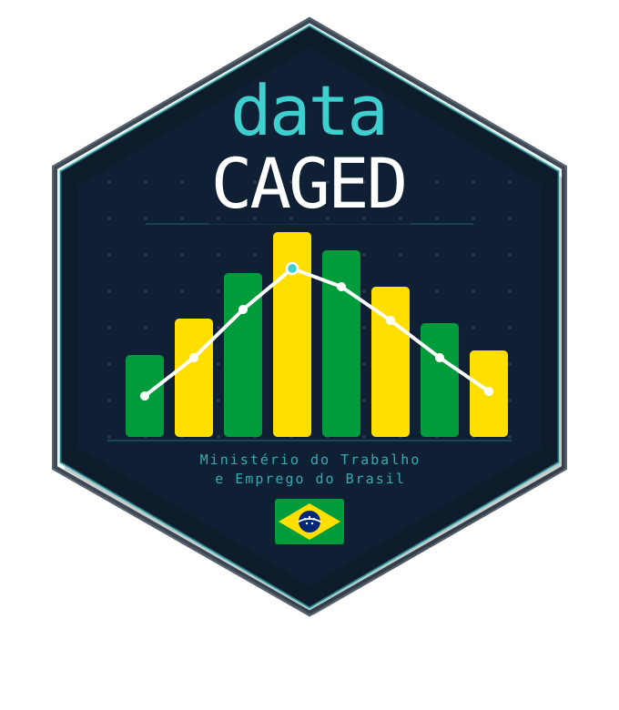

::: {.pacote-header}
::: {.pacote-header-logo}
{fig-alt="Logo hexagonal do pacote dataCAGED"}
:::

::: {.pacote-header-texto}
::: {.lead}
O **dataCAGED** (pacote R `datacaged`) automatiza todo o fluxo de trabalho com os microdados do
Cadastro Geral de Empregados e Desempregados (CAGED): download, leitura e armazenamento em banco
analítico local, pronto para consultas com `dplyr` ou SQL.
:::

::: {.pacote-links}
[`<i class="bi bi-github"></i>`{=html} GitHub](https://github.com/gecomt/datacaged){.btn .btn-gecomt .btn-sm .btn-primary role="button"}
[`<i class="bi bi-box-seam"></i>`{=html} CRAN](https://CRAN.R-project.org/package=datacaged){.btn .btn-gecomt .btn-sm .btn-gecomt-line role="button"}
[`<i class="bi bi-database"></i>`{=html} Dados no Hugging Face](https://huggingface.co/datasets/alexsandroprado/caged){.btn .btn-gecomt .btn-sm .btn-gecomt-line role="button"}
[`<i class="bi bi-bookmark"></i>`{=html} DOI](https://doi.org/10.5281/zenodo.20058818){.btn .btn-gecomt .btn-sm .btn-gecomt-line role="button"}
:::
:::
:::

## Principais recursos

- Download automatizado dos arquivos via HTTPS, a partir de um espelho dos dados do Ministério do
  Trabalho e Emprego (MTE) no Hugging Face, com downloads paralelos e cache local;
- Descompressão em fluxo dos arquivos `.7z`, sem extração para disco temporário;
- Armazenamento em banco **DuckDB** local, com consultas rápidas mesmo em grandes volumes;
- Cobertura do Novo CAGED (2020 em diante), do CAGED antigo (2007 a 2019) e dos ajustes históricos;
- Atualização incremental (`caged_update()`) e exportação para Parquet (`caged_to_parquet()`);
- Compatível com Windows, macOS e Linux.

## Instalação

```r
# Versão estável (CRAN)
install.packages("datacaged")

# Versão de desenvolvimento (GitHub)
pak::pak("gecomt/datacaged")
```

::: {.callout-note appearance="simple"}
Os arquivos do CAGED antigo (anteriores a 2020) utilizam compressão PPMd e exigem o
[7-Zip](https://www.7-zip.org/download.html) instalado. O Novo CAGED funciona sem software adicional.
:::

## Uso rápido

```r
library(datacaged)
library(dplyr)

# Pipeline completo: baixa, lê e grava no DuckDB
caged_load(
  years   = 2022:2023,
  months  = seq_len(12L),
  db_path = "caged.duckdb"
)

# Conexão e consulta
con <- caged_connect("caged.duckdb")

tbl(con, "caged_mov") |>
  filter(uf == 24, competenciamov >= 202201L) |>
  group_by(competenciamov) |>
  summarise(saldo = sum(saldomovimentacao, na.rm = TRUE)) |>
  collect()

DBI::dbDisconnect(con, shutdown = TRUE)
```

## Estrutura do banco

| Tabela | Conteúdo | Período |
|---|---|---|
| `caged_mov` | Movimentações | 2020 em diante |
| `caged_for` | Declarações fora do prazo | 2020 em diante |
| `caged_exc` | Exclusões | 2020 em diante |
| `caged_antigo` | Histórico | 2007 a 2019 |
| `caged_ajustes` | Ajustes retroativos | 2002 a 2019 |

## Funções principais

| Função | Descrição |
|---|---|
| `caged_load()` | Pipeline completo (download, leitura e gravação no DuckDB) |
| `caged_adjustments_load()` | Pipeline dos ajustes |
| `caged_update()` | Baixa apenas as competências novas |
| `caged_connect()` | Abre a conexão com o banco |
| `caged_info()` | Estatísticas do banco |
| `caged_hf_files()` | Lista as competências disponíveis |
| `caged_to_parquet()` | Exporta tabelas para Parquet |

## Como citar

```r
citation("datacaged")
```

## Posts sobre o dataCAGED

::: {#posts-datacaged}
:::
