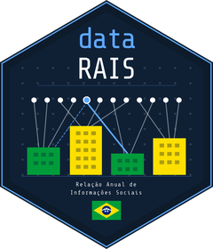

::: {.pacote-header}
::: {.pacote-header-logo}
{fig-alt="Logo hexagonal do pacote dataRAIS"}
:::

::: {.pacote-header-texto}
::: {.lead}
O **dataRAIS** (pacote R `datarais`) dá acesso aos microdados da Relação Anual de Informações
Sociais (RAIS), o censo anual do emprego formal no Brasil, cobrindo vínculos e estabelecimentos de
1985 a 2025, armazenados em banco DuckDB local.
:::

::: {.pacote-links}
[`<i class="bi bi-github"></i>`{=html} GitHub](https://github.com/gecomt/datarais){.btn .btn-gecomt .btn-sm .btn-primary role="button"}
[`<i class="bi bi-database"></i>`{=html} Dados no Hugging Face](https://huggingface.co/datasets/alexsandroprado/rais){.btn .btn-gecomt .btn-sm .btn-gecomt-line role="button"}
[`<i class="bi bi-bug"></i>`{=html} Reportar problema](https://github.com/gecomt/datarais/issues){.btn .btn-gecomt .btn-sm .btn-gecomt-line role="button"}
:::
:::
:::

## Principais recursos

- Download dos arquivos a partir de um espelho da RAIS no Hugging Face, com cache persistente e
  downloads paralelos opcionais;
- Suporte aos dois formatos de distribuição: arquivos por Unidade da Federação (1985 a 2017) e por
  região geográfica (2018 em diante);
- Nomes de variáveis normalizados em português (*snake_case*), consistentes entre todos os leiautes
  históricos;
- Dicionário de variáveis integrado (`rais_col_info()`) e resumo dos leiautes (`rais_layouts()`);
- Atualização incremental (`rais_update()`) e exportação para Parquet (`rais_to_parquet()`);
- Mensagens em português e em inglês.

## Instalação

```r
# Versão de desenvolvimento (GitHub)
pak::pak("gecomt/datarais")
```

::: {.callout-note appearance="simple"}
Os arquivos anteriores a 2020 utilizam compressão PPMd e exigem o
[7-Zip](https://www.7-zip.org/download.html) instalado. Recomenda-se, ainda, ao menos 8 GB de RAM e
cerca de 20 GB livres em disco por ano de dados de vínculos.
:::

## Uso rápido

```r
library(datarais)
library(dplyr)

# Verifica a disponibilidade do repositório
rais_status()

# Download, leitura e gravação no DuckDB em uma etapa
rais_load(
  years   = 2022:2023,
  type    = "vinculos",
  db_path = "rais.duckdb"
)

con <- rais_connect("rais.duckdb")

tbl(con, "rais_novo") |>
  filter(ano == 2023) |>
  group_by(sigla_uf) |>
  summarise(
    vinculos           = n(),
    remuneracao_media  = mean(vl_remun_media_nom, na.rm = TRUE)
  ) |>
  arrange(desc(remuneracao_media)) |>
  collect()

DBI::dbDisconnect(con, shutdown = TRUE)
```

## Tabelas no DuckDB

| Tabela | Conteúdo | Período |
|---|---|---|
| `rais_antigo` | Vínculos por Unidade da Federação | 1985 a 2017 |
| `rais_novo` | Vínculos por região | 2018 em diante |
| `rais_estab` | Estabelecimentos | 1985 em diante |

## Funções principais

| Função | Descrição |
|---|---|
| `rais_load()` | Pipeline completo (download, leitura e gravação no DuckDB) |
| `rais_update()` | Baixa apenas os anos ainda ausentes no banco |
| `rais_connect()` / `rais_tbl()` | Conexão e referência às tabelas |
| `rais_available()` | Anos disponíveis no Hugging Face |
| `rais_col_info()` | Metadados das variáveis (tipo, descrição e disponibilidade) |
| `rais_layouts()` | Resumo dos leiautes históricos |
| `rais_to_parquet()` | Exporta tabelas para Parquet |

## Como citar

```r
citation("datarais")
```

## Posts sobre o dataRAIS

::: {#posts-datarais}
:::
