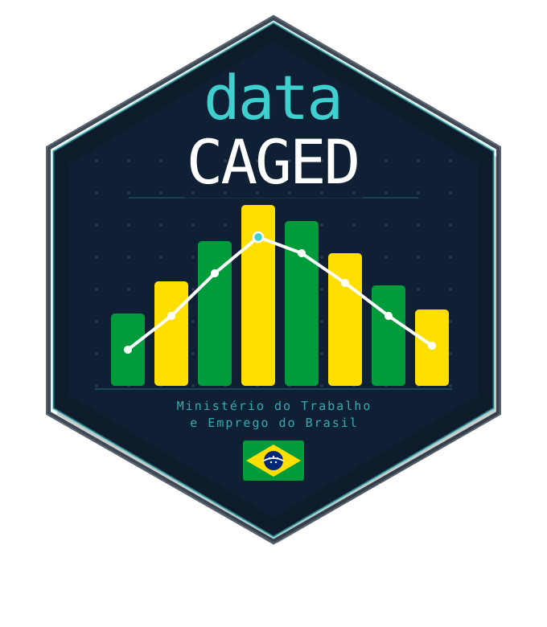
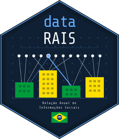

## Pacotes R

::: {.grid .gap-4}
::: {.g-col-12 .g-col-md-6}
::: {.gecomt-card .pacote-card}
{fig-alt="Logo hexagonal do pacote dataCAGED" .pacote-hex}

### dataCAGED

Microdados do CAGED (Novo CAGED, CAGED antigo e ajustes) em banco DuckDB local. Disponível no CRAN.

[Página do pacote](pacotes/datacaged.qmd) ·
[GitHub](https://github.com/gecomt/datacaged) ·
[CRAN](https://CRAN.R-project.org/package=datacaged) ·
[DOI](https://doi.org/10.5281/zenodo.20058818)
:::
:::

::: {.g-col-12 .g-col-md-6}
::: {.gecomt-card .pacote-card}
{fig-alt="Logo hexagonal do pacote dataRAIS" .pacote-hex}

### dataRAIS

Microdados da RAIS de 1985 a 2025 (vínculos e estabelecimentos), com variáveis padronizadas entre leiautes.

[Página do pacote](pacotes/datarais.qmd) ·
[GitHub](https://github.com/gecomt/datarais)
:::
:::
:::

## Painel do Mercado de Trabalho

::: {.gecomt-card}
[`<i class="bi bi-speedometer2" aria-hidden="true"></i>`{=html}]{.gecomt-icon}

### Painel do Mercado de Trabalho

Indicadores da PNAD Contínua, do Novo CAGED e da RAIS, com recorte dedicado aos profissionais
contábeis. Os dados são atualizados com os pacotes dataCAGED e dataRAIS.

[Abrir o painel](dashboard/index.qmd)
:::

## Dados abertos

::: {.grid .gap-4}
::: {.g-col-12 .g-col-md-6}
::: {.gecomt-card}
[`<i class="bi bi-cloud-arrow-down-fill" aria-hidden="true"></i>`{=html}]{.gecomt-icon}

### Espelho do CAGED

Microdados do CAGED disponibilizados pelo Ministério do Trabalho e Emprego, organizados no Hugging Face.

[Hugging Face](https://huggingface.co/datasets/alexsandroprado/caged)
:::
:::

::: {.g-col-12 .g-col-md-6}
::: {.gecomt-card}
[`<i class="bi bi-cloud-arrow-down-fill" aria-hidden="true"></i>`{=html}]{.gecomt-icon}

### Espelho da RAIS

Microdados da RAIS (vínculos, estabelecimentos e trabalho doméstico), organizados no Hugging Face.

[Hugging Face](https://huggingface.co/datasets/alexsandroprado/rais)
:::
:::
:::

## Projetos parceiros

::: {.grid .gap-4}
::: {.g-col-12 .g-col-md-6}
::: {.gecomt-card}
[`<i class="bi bi-bar-chart-line-fill" aria-hidden="true"></i>`{=html}]{.gecomt-icon}

### contabiliDados

Grupo dedicado à contabilidade e ciência de dados, com materiais, eventos e aplicativos sobre
informações contábeis de companhias abertas.

[contabilidados.com.br](https://contabilidados.com.br/)
:::
:::

::: {.g-col-12 .g-col-md-6}
::: {.gecomt-card}
[`<i class="bi bi-clipboard-data-fill" aria-hidden="true"></i>`{=html}]{.gecomt-icon}

### Regulariza

Painel interativo do projeto Regulariza.

[Abrir o painel](https://regulariza.shinyapps.io/dashboard/)
:::
:::
:::

::: {.callout-note appearance="simple"}
Esta página é atualizada continuamente. Artigos, capítulos, trabalhos em eventos e trabalhos
orientados podem ser incluídos em novas seções, no formato de lista.
:::
